# ZEmpire Auto Accessories – ERD

Generated from `Models/*.cs` and `Data/ApplicationDbContext.cs`. Schemas: `cat`, `crm`, `inv`, `ops`, `sales`, `sec` (+ ASP.NET Identity). Dashed/optional (`o`) = nullable FK.

```mermaid
erDiagram
    %% ===== cat =====
    ProductCategory ||--o{ Product : has
    Product ||--o{ TintVariant : has
    TintVariant ||--o{ Shade : has
    ServiceCategory ||--o{ Service : has
    Product ||--o{ Pricing : priced
    TintVariant |o--o{ Pricing : "optional"
    VehicleClassification ||--o{ Pricing : for
    Panel ||--o{ Pricing : for
    Pricing ||--o{ PriceHistory : logs
    AspNetUsers ||--o{ PriceHistory : changed_by

    %% ===== crm =====
    Customer ||--o{ Vehicle : owns
    VehicleClassification ||--o{ Vehicle : classifies

    %% ===== inv =====
    Product ||--o{ InventoryTransaction : moves
    AspNetUsers ||--o{ InventoryTransaction : records
    AspNetUsers ||--o{ InventoryCheck : performs
    InventoryCheck ||--o{ InventoryCheckDetail : contains
    Product ||--o{ InventoryCheckDetail : counts
    TintVariant |o--o{ InventoryCheckDetail : "optional"
    Shade |o--o{ InventoryCheckDetail : "optional"

    %% ===== sales: quotation =====
    Customer ||--o{ Quotation : requests
    Vehicle ||--o{ Quotation : for
    AspNetUsers ||--o{ Quotation : prepares
    JobType |o--o{ Quotation : type
    Quotation ||--o{ QuotationDetail : contains
    Product |o--o{ QuotationDetail : item
    Service |o--o{ QuotationDetail : item
    TintVariant |o--o{ QuotationDetail : item
    Shade |o--o{ QuotationDetail : item
    Panel |o--o{ QuotationDetail : item
    Pricing |o--o{ QuotationDetail : item

    %% ===== ops =====
    Quotation |o--o| JobOrder : "converted to"
    Customer ||--o{ JobOrder : places
    Vehicle ||--o{ JobOrder : serviced
    AspNetUsers ||--o{ JobOrder : creates
    JobType |o--o{ JobOrder : type
    Employee |o--o{ JobOrder : assigned
    JobOrder ||--o{ JobOrderDetail : contains
    Product |o--o{ JobOrderDetail : item
    Service |o--o{ JobOrderDetail : item
    TintVariant |o--o{ JobOrderDetail : item
    Shade |o--o{ JobOrderDetail : item
    Panel |o--o{ JobOrderDetail : item
    Pricing |o--o{ JobOrderDetail : item
    JobOrder ||--o{ VehicleChecklist : has
    AspNetUsers ||--o{ VehicleChecklist : completes
    VehicleChecklist ||--o{ VehicleChecklistDetail : contains
    Panel ||--o{ VehicleChecklistDetail : inspected

    %% ===== sales: product sales =====
    PaymentMode ||--o{ Sales : paid_by
    Customer ||--o{ Sales : buys
    Vehicle |o--o{ Sales : for
    AspNetUsers ||--o{ Sales : processes
    Sales ||--o{ SalesDetail : contains
    Product ||--o{ SalesDetail : sold

    %% ===== sales: service invoice =====
    InvoiceNoSeries ||--o{ ServiceInvoice : numbers
    AspNetUsers ||--o{ InvoiceNoSeries : manages
    JobOrder |o--o{ ServiceInvoice : billed
    Customer ||--o{ ServiceInvoice : billed_to
    Vehicle |o--o{ ServiceInvoice : for
    AspNetUsers ||--o{ ServiceInvoice : issues
    PaymentMode ||--o{ ServiceInvoice : paid_by
    ServiceInvoice ||--o{ ServiceInvoiceDetail : contains
    Product |o--o{ ServiceInvoiceDetail : item
    Service |o--o{ ServiceInvoiceDetail : item
    TintVariant |o--o{ ServiceInvoiceDetail : item
    Shade |o--o{ ServiceInvoiceDetail : item
    Panel |o--o{ ServiceInvoiceDetail : item

    %% ===== warranty =====
    SalesDetail |o--o{ Warranty : covers
    ServiceInvoiceDetail |o--o{ Warranty : covers
    JobOrder |o--o{ Warranty : covers

    %% ===== sec =====
    AspNetUsers ||--o| Employee : "is"
    AspNetRoles ||--o{ RolePermission : grants
    Module ||--o{ RolePermission : "access to"

    ProductCategory { int CategoryID PK
        string CategoryName }
    Product { int ProductID PK
        int CategoryID FK
        string ProductName
        decimal DefaultPrice
        bool IsActive }
    TintVariant { int TintVariantID PK
        int ProductID FK
        string VariantName }
    Shade { int ShadeID PK
        int TintVariantID FK
        string ShadeName }
    Panel { int PanelID PK
        string PanelName }
    ServiceCategory { int ServiceCategoryID PK
        string CategoryName }
    Service { int ServiceID PK
        int ServiceCategoryID FK
        string ServiceName
        decimal DefaultPrice
        bool IsActive }
    JobType { int JobTypeID PK
        string JobTypeName }
    Pricing { int PricingID PK
        int ProductID FK
        int TintVariantID FK
        int VehicleClassificationID FK
        int PanelID FK
        decimal Price }
    PriceHistory { int HistoryID PK
        int PricingID FK
        string UserId FK
        decimal OldPrice
        decimal NewPrice
        datetime DateChanged }
    Customer { int CustomerID PK
        string FullName
        string ContactNumber
        datetime CreatedAt }
    VehicleClassification { int VehicleClassificationID PK
        string ClassificationName }
    Vehicle { int VehicleID PK
        int CustomerID FK
        int VehicleClassificationID FK
        string PlateNumber
        string Brand
        string Model
        short ManufacturingYear }
    InventoryTransaction { int InventoryTransactionID PK
        int ProductID FK
        string UserId FK
        string TransactionType
        decimal Quantity
        datetime TransactionDate }
    InventoryCheck { int InventoryCheckID PK
        string UserId FK
        datetime CheckDate }
    InventoryCheckDetail { int InventoryCheckDetailID PK
        int InventoryCheckID FK
        int ProductID FK
        int TintVariantID FK
        int ShadeID FK
        decimal PhysicalStock
        string StockLevel
        string Unit }
    Quotation { int QuotationID PK
        string QuotationNumber
        int CustomerID FK
        int VehicleID FK
        string UserId FK
        int JobTypeID FK
        datetime QuotationDate
        decimal TotalAmount
        string Status }
    QuotationDetail { int QuotationDetailID PK
        int QuotationID FK
        int ProductID FK
        int ServiceID FK
        int TintVariantID FK
        int ShadeID FK
        int PanelID FK
        int PricingID FK
        int Quantity
        decimal UnitPrice
        decimal SubTotal }
    JobOrder { int JobOrderID PK
        string JobOrderNumber
        int CustomerID FK
        int VehicleID FK
        string UserId FK
        int JobTypeID FK
        int AssignedEmployeeID FK
        int QuotationID FK
        datetime JobOrderDate
        datetime InstallationDate
        string Status }
    JobOrderDetail { int JobOrderDetailID PK
        int JobOrderID FK
        int ProductID FK
        int ServiceID FK
        int TintVariantID FK
        int ShadeID FK
        int PanelID FK
        int PricingID FK
        int Quantity
        decimal UnitPrice
        decimal SubTotal }
    VehicleChecklist { int ChecklistID PK
        int JobOrderID FK
        string UserId FK
        datetime ChecklistDate
        string AdditionalNotes }
    VehicleChecklistDetail { int VehicleChecklistDetailID PK
        int ChecklistID FK
        int PanelID FK
        string ExistingCondition
        string Notes }
    PaymentMode { int PaymentModeID PK
        string PaymentModeName }
    Sales { int SalesID PK
        string InvoiceNumber
        int CustomerID FK
        int VehicleID FK
        string UserId FK
        int PaymentModeID FK
        datetime SalesDate
        decimal TotalAmount }
    SalesDetail { int SalesDetailID PK
        int SalesID FK
        int ProductID FK
        int Quantity
        decimal UnitPrice
        decimal SubTotal }
    InvoiceNoSeries { int InvoiceNoSeriesID PK
        string UserId FK
        int SeriesYear
        string Prefix
        int CurrentNumber
        bool IsActive }
    ServiceInvoice { int ServiceInvoiceID PK
        string InvoiceNumber
        int InvoiceNoSeriesID FK
        int JobOrderID FK
        int CustomerID FK
        int VehicleID FK
        string UserId FK
        int PaymentModeID FK
        decimal TotalAmount
        decimal AmountPaid
        string Status }
    ServiceInvoiceDetail { int ServiceInvoiceDetailID PK
        int ServiceInvoiceID FK
        int ProductID FK
        int ServiceID FK
        int TintVariantID FK
        int ShadeID FK
        int PanelID FK
        decimal Quantity
        decimal UnitPrice
        decimal SubTotal }
    Warranty { int WarrantyID PK
        int SalesDetailID FK
        int ServiceInvoiceDetailID FK
        int JobOrderID FK
        date WarrantyStartDate
        date WarrantyEndDate
        string WarrantyStatus }
    Employee { int EmployeeID PK
        string UserId FK
        string EmployeeNumber
        string FullName
        string ContactNumber
        bool IsActive }
    Module { int ModuleID PK
        string ModuleName }
    RolePermission { string RoleId PK
        int ModuleID PK
        bool CanAccess }
    AspNetUsers { string Id PK
        string FullName
        bool IsActive
        datetime CreatedAt }
    AspNetRoles { string Id PK
        string Name }
```

